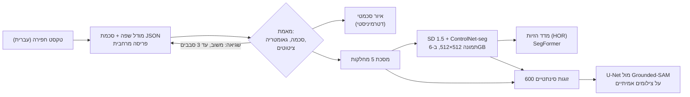

# תדריך פרויקט להכנת מצגת: "מדו"ח חפירה לאיור האתר"

> **מסמך היסטורי (עד 17.11.2026), שלא עודכן מאז.** המצב, התוצאות והמספרים העדכניים נמצאים ב-[README.md](../README.md) וב-[slides/](../slides).

> **למודל השפה שקורא את המסמך הזה:** המסמך מרכז את כל מה שצריך כדי להכין מצגת ראשונית בעברית על פרויקט בקורס מודלים עמוקים ללמידה יוצרת (Gen-AI). כל המספרים כאן נמדדו בפועל. אל תעגל אותם מחדש, אל תמציא תוצאות, ואל תציג כתוצאה משהו שמסומן כאן כ"פתוח" או "מתוכנן". חלק ב' של הקורס **עדיין בלי תוצאות על צילומים אמיתיים**, ויש לומר זאת במפורש. בסוף המסמך יש הצעה למבנה של 15 שקפים ורשימת תמונות זמינות.

עודכן: 17 בנובמבר 2026.

> **חשוב:** שאלת המחקר, ההשערות, המדדים והיקף העבודה עודכנו בעקבות סקירה חיצונית. הגרסה המחייבת נמצאת ב-[project_focus.md](project_focus.md), גרסה 2. במקרה של סתירה, הגרסה ההיא קובעת. המסמך הזה משמש כנספח של מספרים, תוצאות ותמונות.

## 1. פרטים

| שדה | פרט |
|---|---|
| מגיש | שון גלר ינוביץ' |
| מוסד | מכון טכנולוגי חולון (HIT), החוג למדעי המחשב |
| קורס | מודלים עמוקים ללמידה יוצרת (Deep Generative Models) |
| מרצה | ד"ר אלכסנדר (סשה) אפרצין |
| חומרה | מחשב נייד עם RTX 3050 Laptop, 6GB VRAM |
| מאגר קוד | github.com/ssen2803/arch-to-image (פרטי) |

## 2. במשפט אחד

הפרויקט הופך תיאור כתוב של חפירה ארכיאולוגית לפריסה מרחבית מובנית, מייצר ממנה תמונה בדיפוזיה מבוקרת, ומודד בכלי ראייה ממוחשבת כמה מהמבנה שבטקסט באמת נשמר בתמונה, וכמה המודל המציא.

**המטרה ארוכת הטווח:** שחזור מקורב של האתר כפי שהיה בתקופה הנחקרת, קרוב למציאות ככל שהראיות מאפשרות ולא יותר מזה. בהמשך, גם טופולוגיה של אתר שמצליבה כמה דו"חות חפירה.

## 3. הבעיה והמוטיבציה

- דו"חות חפירה, למשל בסדרה "חדשות ארכיאולוגיות" של רשות העתיקות, הם בעיקר טקסט טכני: קירות, רצפות, מתקנים ובורות, עם מידות ויחסים מרחביים. קשה לדמיין מהם את האתר.
- מודלים יוצרים יודעים לייצר תמונות משכנעות, אבל ממציאים פרטים. בארכיאולוגיה תמונה משכנעת עם פרטים מומצאים מטעה, כי היא נראית כמו עובדה.
- לכן השאלה המעניינת אינה רק "אפשר לייצר תמונה?", אלא "כמה מהתמונה נאמן לטקסט, ואיך מודדים את זה?".

## 4. הפער המחקרי

**השיטה עצמה אינה חדשה.** הרצף "מודל שפה מתכנן פריסה, דיפוזיה מרנדרת, גלאי מודד" פורסם ב-2023 על תמונות כלליות: LayoutGPT, VPGen/VPEval, LMD.

**העבודות הקרובות ביותר בתחום המורשת מכסות 2 עד 3 שלבים בלבד:**

| עבודה | מה יש בה | מה חסר |
|---|---|---|
| Li et al. 2025 (מקדש Gonghoulong) | מודל שפה קורא תוכנית אתר | המחולל מתואר רק במילים, ואין מדידה של התמונות |
| HARF (2026) | ראיות ארכיאולוגיות הופכות לפרומפטים, ומומחים מעריכים את התוצאה | אין התניה על פריסה |
| Guo et al. 2026 (Huizhou) | ControlNet מתוך גרף ידע | לא מודל שפה, וחזיתות ולא פריסת אתר |
| CalliMaster 2026 | טקסט ← פריסה ← תמונה | קליגרפיה ולא אתרים |

**החידוש שאפשר להגן עליו הוא בתחום ובמדידה:** מימוש ראשון של הצנרת על פרוזה של דו"חות חפירה, ובפרט בעברית, עם מדידה כמותית בראייה ממוחשבת שמעוגנת בתוכנית האתר.

הסקירה כללה כ-130 שאילתות בשבעה ערוצים, ומטריצת כיסוי של 35 עבודות. רמת הביטחון שאין עבודה עם כל ארבעת השלבים בתחום המורשת: כ-75%. רמת הביטחון שהשיטה כשיטה אינה חדשה: כ-90%.

## 5. שאלת המחקר וההשערות

**שאלת המחקר:** כשהפריסה מחולצת מהטקסט העברי של הדו"ח על ידי מודל שפה, איזה חלק מנאמנות הפריסה נשמר, בהשוואה להתניה על התוכנית המקורית? הנאמנות נמדדת ב-mIoU לכל מחלקה.

**המדד המסכם:**

```
Retention = (S_LLM − S_text) / (S_oracle − S_text)
```

| תנאי | מה מקבל המחולל |
|---|---|
| S_text | פרומפט מהטקסט בלבד, בלי התניה מרחבית (רצפה) |
| S_LLM | פריסה שחילץ מודל השפה (המערכת המוצעת) |
| S_oracle | פריסה מהתוכנית המקורית (תקרה) |

**השערות:**
1. **H1:** התניה על פריסה מעלה את שיעור האלמנטים שצוירו ומורידה את שיעור ההזיה, לעומת טקסט בלבד. *(נתמכת בתוצאות חלק א')*
2. **H2:** ערך Retention נמוך מ-1, והפער מכמת את המחיר של פרשנות מודל השפה. *(טרם נבדקה)*
3. **H3:** U-Net שאומן על נתונים סינתטיים עולה על מודל zero-shot בצילומי חפירה אמיתיים. *(טרם נבדקה)*
4. **H4:** אין הטיה להקשר: על צירופים שלא נראו באימון, הביצועים לא יורדים באופן מובהק. *(טרם נבדקה)*

## 6. הכרעת הסגנון, ועקרון הענווה

**ההכרעה בשלב 1:** התוצר הראשי הוא איור סכמטי מקודד-ראיות, ולא צילום ריאליסטי. הנימוקים:
- צילום ריאליסטי משדר ודאות שהראיות לא מצדיקות. London Charter ו-Seville Principles דורשים להראות את רמת הוודאות.
- בסכמה כל מחלקה מקבלת צבע קבוע, וסגנון הקו מקודד את רמת הראיה: קו רציף למה שנחשף, מקווקו למה שהוסק, ומנוקד להיפותטי.

**עדכון שנמצא בדיון (הצעה, טרם הוכרעה):** את האיור הסכמטי אפשר להפיק ישירות מהפריסה, באופן דטרמיניסטי ונאמן לחלוטין, בלי דיפוזיה. לכן תפקיד הדיפוזיה הוא "תמונת שחזור": איך האתר אולי נראה. התמונה מסומנת כשחזור היפותטי ומלווה במדד הזיות. אימון LoRA שמחקה את הרינדור הסכמטי הוא מעגלי, ולכן לא מומש.

**חמישה עקרונות שמלווים את כל המערכת:**
1. **ספציפיות לפי הראיה:** המערכת אומרת "טאבון" רק כשהטקסט אומר טאבון. אחרת היא חוזרת ל"מתקן".
2. **לא ידוע אינו ריק:** שטח שלא נחפר מוצג כלא ידוע.
3. **מקור לכל טענה:** כל אלמנט נושא ציטוט מילה במילה מהדו"ח.
4. **סתירות מוצגות, לא ממוצעות.**
5. **מודעות להטיית דגימה:** רוב החפירות הן חפירות הצלה, שנעשות איפה שבונים היום.

## 7. הצנרת



| שלב | תוכן | תיקייה במאגר |
|---|---|---|
| 1 | סקירת ספרות, שאלת מחקר, הכרעת סגנון | `01_literature_review` |
| 2 | טקסט ← פריסה: אונטולוגיה, סכמה, מחלץ, מאמת | `02_layout_pipeline` |
| 3 (חלק א' בקורס) | יצירה מבוקרת ב-6GB ומדד הזיות | `03_controlled_generation` |
| 4 (חלק ב' בקורס) | סגמנטציה: U-Net על נתונים סינתטיים מול zero-shot | `04_cv_experiment` |

## 8. שלב 2: טקסט ← פריסה

**אונטולוגיה של 5 מחלקות:**

| מחלקה | מה נכלל | צבע |
|---|---|---|
| רקע | כל מה שאינו אלמנט | בז' |
| רצפה | רצפת עפר, טיח, ריצוף אבנים, פסיפס, משטח דריכה | צהוב-חול |
| קיר | קירות, יסודות, קירות מחיצה | חום כהה |
| מתקן | טאבון, תנור, מוקד אש, ספסל, אגן, בור איגום מטויח | אדום-לבנה |
| בור | בור, ממגורה חפורה, גומה, מאגר חצוב, קבר | כחול |

**מה כל אלמנט נושא (סכמת JSON 1.2):**
- תיבה במטרים ומחלקה.
- **רמת ראיה:** נחשף, הוסק או היפותטי.
- **מקור המיקום:** נאמר, נגזר מיחס לאלמנט אחר, או לא ידוע.
- **מונח מאוצר מונחים היררכי של 31 מונחים** (למשל posthole ← socket ← pit), עם סימון אם המונח נאמר בטקסט או הוסק.
- **שדות אופציונליים:** חומר, תיארוך, גבהים מעל פני הים, ועיגון לרשת ישראל.
- **יחסים מרחביים (9):** ארבעת הכיוונים, בתוך, על, צמוד ל, חותך, מתחת ל.

**המחלץ:** Claude עם פלט מובנה לפי הסכמה. המאמת בודק כל יחס גאומטרית, ובודק שכל ציטוט מופיע מילה במילה בדו"ח. בשגיאה המודל מקבל משוב ומנסה שוב, עד 3 פעמים. **המחלץ טרם הורץ על דו"חות אמיתיים:** אין עדיין מפתח API, והשימוש בדו"חות ממתין לאישור.

**ממצא, ביקורת עצמית:** הכלל "ספציפיות לפי הראיה" הופעל על 7 דוגמאות ה-gold שנכתבו ידנית. הוא מצא ש-8 מתוך 35 אלמנטים (23%) תוארו ספציפית יותר מהטקסט: 7 קירות קיבלו "אבן" או "אבני שדה" שלא נאמרו, ובור אחד סומן "בור אשפה" לפי תוכן המילוי בלבד. כלומר גם מתייג אנושי "הוזה". ה-gold תוקן.

**8 דוגמאות סינתטיות** בסגנון "חדשות ארכיאולוגיות". אלה טקסטים שנכתבו לצורך הדגמה, ולא דו"חות אמיתיים. ביניהן:
- **ex06:** בור שמיקומו לא נאמר מוצג כאזור אי-ודאות מקווקו, ולא בנקודה מומצאת.
- **ex07:** ממגורה שנאטמה מתחת לרצפה נגזמת מהתמונה, ומופיעה באיור כקו מנוקד "(below)".
- **ex08:** שני שלבי בנייה, תקופת הברזל ב' והתקופה הפרסית, עם מפת תקופה וחתך אנכי.

## 9. חלק א': יצירה מבוקרת ב-6GB VRAM

**המודל:** Stable Diffusion 1.5 עם ControlNet למפות סגמנטציה (control_v11p_sd15_seg), 30 צעדי UniPC.

| אילוץ חומרה | מימוש | נמדד |
|---|---|---|
| FP16 | משקולות וחישוב בחצי דיוק | שיא 3,111–3,119MB מתוך 6,144MB |
| xformers | attention חסכוני, עם מעבר מבוקר ל-SDPA | xformers 0.0.35 פעל |
| CPU offloading | כל תת-מודל עולה ל-GPU רק בזמן השימוש בו | 9.4 שניות לתמונה |

**מיפוי מחלקות:** ControlNet-seg מכיר רק את צבעי ADE20K, ולכן כל מחלקה ממופה למחלקת ADE20K קרובה: רקע ← earth, רצפה ← floor, קיר ← wall, מתקן ← fireplace, בור ← swimming pool.

**מדד ההזיות (Hallucinated Object Rate):**
- **איך מזהים הזיה:** מקטע מוכן (SegFormer-B4, ADE20K) הופך את התמונה למפת מחלקות. אובייקט מוזה הוא רכיב קשיר של מחלקה מסוימת שנמצא מחוץ לאזור המותר שלה בפריסה.
- `HOR = מוזים / (מוזים + נכונים)`: בסגנון CHAIR.
- `HOR_area`: חלק השטח המצויר שאין לו עיגון בפריסה.
- `Recall`: איזה חלק מאלמנטי הפריסה נמצא בתמונה.
- `HAR`: איזה חלק מהשטח שאמור להיות ריק התמלא במבנים.
- שטח מחוץ לגבול החפירה נחשב "לא ידוע" ולא נספר. המדידה העיקרית ברזולוציה גסה של שלוש קבוצות: בנוי, קרקע, בור.

**תוצאות** (סגנון צילום, רזולוציה גסה, 5 פריסות × 4 seeds = 20 תמונות לכל תנאי):

| תנאי | HOR ↓ | HOR_area ↓ | Recall ↑ | HAR ↓ | רכיבים זרים ↓ |
|---|---|---|---|---|---|
| ControlNet (מסכה) | **0.625** | **0.729** | **0.632** | 0.640 | 2.10 |
| GLIGEN (תיבה וביטוי לכל אלמנט) | 0.763 | 0.787 | 0.497 | 0.569 | 3.85 |
| טקסט בלבד, בלי פריסה | 0.823 | 0.775 | 0.203 | **0.219** | 0.65 |
| ControlNet, רקע ממופה ל-sand | 0.593 | 0.771 | 0.642 | 0.772 | 1.65 |

**ממצאים:**
1. **ControlNet מצייר את הפריסה.** ה-Recall עולה פי שלושה לעומת טקסט בלבד. בהשוואה מזווגת (אותה פריסה ואותו seed), ControlNet טוב יותר ב-17 מתוך 20 זוגות ב-HOR וב-Recall.
2. **"סגירת חדרים":** בשטח שאמור להיות ריק, ControlNet מצייר קירות מומצאים. הוא טוב יותר רק ב-3 מתוך 20 זוגות ב-HAR. ההסבר הסביר: ב-ADE20K רצפה כמעט תמיד מוקפת קירות. זו ההזיה העיקרית.
3. **קידוד הראיות לא עובר דרך ControlNet:** קיר היפותטי מצויר בדיוק כמו קיר שנחשף.
4. **הסגנון הסכמטי לא מדיד** עם המעריך הנוכחי: SegFormer רואה באיור פוסטר או מסך.
5. **מיפוי הרקע ל-sand החמיר את HAR** (0.772 מול 0.640), ולכן earth נשאר. ההחלטה התקבלה לפי המדד.
6. **GLIGEN אינו תחליף ל-ControlNet:** הוא ממציא פחות בשטח הריק (טוב יותר ב-14 מתוך 20 זוגות ב-HAR), אבל פחות נאמן מרחבית. הוא טוב יותר רק ב-4 מתוך 20 זוגות ב-HOR. בעין, התמונות נראות כמו פוסטר עם טקסט חסר משמעות.
7. **מסנן הבטיחות של SD מחזיר לפעמים תמונה שחורה** גם על תמונות חפירה רגילות: 3 מקרים בכ-620 תמונות. כל המחוללים מנסים עכשיו seed אחר כשזה קורה.

**מגבלה:** המספרים המוחלטים כוללים רעש של המעריך. לפני דיווח סופי מתוכננת ביקורת אנושית על 30 תמונות (171 אזורים מסומנים). המדגם מוכן, אבל הדירוג טרם בוצע.

## 10. חלק ב': סגמנטציה על נתונים סינתטיים

**הנתונים:** מחולל פרוצדורלי יוצר 300 פריסות (60% חדרים, 40% שטח פתוח). כל פריסה מצוירת פעמיים ב-ControlNet, ובסך הכול יש 600 תמונות עם תיוג מלא. הייצור לוקח 12.6 שניות לתמונה. החלוקה לאימון ולאימות היא לפי פריסה (540/60).

**המודלים:**

| מודל | פרטים |
|---|---|
| U-Net קטן | מקודד ResNet-18 שאומן מראש על ImageNet, 14.4M פרמטרים. Cross-Entropy משוקלל ועוד 0.5×Dice, AdamW, FP16, batch 8, חיתוכים של 384. נמדד: שיא 1.7GB, כ-17 דקות ל-40 אפוקים |
| zero-shot | Grounded-SAM: GroundingDINO הופך מילים כמו "stone wall" לתיבות, ו-SAM הופך כל תיבה למסכה. SAM לבדו מסמן אובייקטים בלי לומר מה הם |

**מדדי הצלחה:**
- mIoU על 5 המחלקות, עם רווח סמך של 95%.
- קריטריון הצלחה: ההפרש המזווג בין U-Net ל-zero-shot חיובי לאורך כל רווח הסמך.
- ההסכמה בין שני מתייגים אנושיים מדווחת כתקרה.

**קבוצת המבחן, רק צילומים אמיתיים מתויגים:**
- **הבסיס:** הדאטהסט הפתוח של Uziel, Zohar & Jaffe (2026, רישיון MIT), צילומי רחפן של 9 אתרים בישראל שהקירות בהם כבר מתויגים.
- **השלמה:** צילומי רחפן מ-Wikimedia Commons ברישיון CC BY 4.0.
- **גודל:** קבוצת פיתוח של 15 תמונות וקבוצת מבחן של 50–80.
- **בקרה:** פיתוח ומבחן מאתרים שונים. 20% מתויגות פעמיים. קבוצת המבחן מוקפאת בחתימת sha256 לפני הרצה, וסקריפט ההערכה מסרב לרוץ על תמונות סינתטיות.

**מצב:** הקוד מוכן ונבדק, אבל **אין עדיין תוצאות על צילומים אמיתיים**, כי קבוצת המבחן טרם תויגה.

**ממצא: "זליגת תוויות".** ControlNet לא מצייר בדיוק את המסכה, ולכן התיוג הסינתטי רועש.
- **סף של 80% לא ישים:** לפי SegFormer, רק 5 מתוך 600 תמונות (0.8%) מגיעות להתאמה של 0.8.
- **הציון האוטומטי לא אמין:** תמונה עם ציון נמוך מאוד תאמה בעין, ותמונה בציון חציוני הכילה מבנה שלם שלא בתיוג.
- **גם החלופה, סינון בהצלבה, חלשה:** מאמנים על חצי מהפריסות ומנבאים על החצי השני. בין חזרות עם חלוקה שונה, המתאם בין הדירוגים הוא 0.73 בלבד.
- **ההכרעה תהיה אנושית:** דירוג של 40 תמונות יכריע אם לסנן בכלל. המדגם מוכן.

## 11. ארבעה מקרי קצה

| מקרה | הבעיה | הפתרון |
|---|---|---|
| זליגת תוויות | התיוג הסינתטי לא תואם בדיוק את התמונה | רצועת התעלמות של 3 פיקסלים סביב גבולות, סינון בהצלבה, ודירוג אנושי כבקרה |
| הסתרה סטרטיגרפית | "שכבת אפר מתחת לרצפת טיח" אינה נראית מלמעלה | יחס "מתחת ל-". מנוע גאומטרי, ולא מודל השפה, מחליט מה מוסתר ומוחק אותו מהמסכה ומהפרומפט |
| מיקום חסר | "נחשף קיר ובור" בלי לומר איפה הבור | האלמנט מסומן "מיקום לא ידוע" ומוצג כאזור אי-ודאות. מדד נפרד סופר מיקומים שמודל השפה המציא |
| צירופים שלא נראו | האם המודל לומד צירופים או משנן הקשרים? | מוציאים צירוף מהאימון ובוחנים עליו, בלי סיבובים והיפוכים |

## 12. החזון: טופולוגיה של אתר מכמה דו"חות

באתר שכבתי כמו ירושלים, כל חפירה היא חלון דליל לתוך נפח לא ידוע בארבעה ממדים. הנתונים הם ענן של טענות, ולא סריג אחיד.

| ממד | מה מחבר בין חפירות | חוזק הקישור |
|---|---|---|
| מיקום | עיגון לרשת ישראל | מדוד |
| גובה | גובה מוחלט מעל פני הים | מדוד |
| זמן | תקופה כטווח שנים | פרשני |
| סדר שכבות | בתוך חפירה: מה מעל מה. בין חפירות: השערה | מקומי |
| מקור | מי טען, מתי ועל סמך מה | תיעודי |

**מה כבר ממומש** (על דוגמה סינתטית של שני שלבי בנייה):
- **מפת תקופה:** רצפה שכוסתה מאוחר יותר נראית במלואה במפה של התקופה שלה. בתקופה המאוחרת היא מוצגת כקו מתאר "earlier".
- **חתך אנכי:** אלמנטים בגובה מוחלט, ובהם בור שחותך שתי רצפות.

**מה נשאר פתוח:**
- מפת מחלוקות.
- גרף טענות בין דו"חות.
- מדד "עקומת צבירת ידע": כמה מצטמצם שטח אי-הוודאות עם כל דו"ח שנוסף.
- פיילוט על אתר אמיתי.

## 13. מגבלות וסיכונים

| סיכון | מענה |
|---|---|
| זכויות השימוש בדו"חות ובתוכניות שייכות לרשות העתיקות | בקשת אישור נשלחה ב-14.11.2026. אם התשובה שלילית: פריסות gold שנבנות ידנית מהטקסט, ומבחן על מקורות פתוחים בלבד |
| פער בין סינתטי לאמיתי | אוגמנטציה. תוצאה שלילית היא גם ממצא |
| המעריך האוטומטי רועש | ביקורת אנושית (מדגם מוכן) |
| המעריך לא יודע לזהות "טאבון" | נדרש מעריך ברמת התיבה, למשל CLIP או VQA |
| קבוצת מבחן קטנה | גודל שנקבע מפיילוט, והשוואה מזווגת |

## 14. מצב העבודה

| רכיב | מצב |
|---|---|
| סקירת ספרות, שאלת מחקר, הכרעת סגנון | הושלם |
| אונטולוגיה, סכמה 1.2, מאמת, 8 דוגמאות | הושלם |
| יצירה מבוקרת ומדד הזיות, כולל ניסוי GLIGEN | הושלם (100 תמונות) |
| 600 תמונות סינתטיות, U-Net, Grounded-SAM | קוד מוכן ונבדק |
| מפת תקופה וחתך אנכי | אב-טיפוס על דוגמה סינתטית |
| בדיקות אוטומטיות | 140 בדיקות, כולן עוברות |
| תיוג קבוצת הפיתוח והמבחן האמיתיות | לא התחיל. זה הנתיב הקריטי |
| דירוגים אנושיים (התאמת תיוג, מדד הזיות) | מדגמים מוכנים, ממתינים לדירוג |
| הרצת המחלץ על דו"חות אמיתיים | ממתין לאישור רשות העתיקות ולמפתח API |

## 15. מספרים מרכזיים

| מה | ערך |
|---|---|
| שיא זיכרון בייצור (SD 1.5 + ControlNet) | 3.1GB מתוך 6GB |
| זמן ייצור לתמונה | 9.4 שניות (ControlNet), 15 שניות (GLIGEN) |
| Recall: ControlNet מול טקסט בלבד | 0.632 מול 0.203 (פי 3) |
| זוגות שבהם ControlNet טוב יותר ב-HOR | 17 מתוך 20 |
| HAR ("סגירת חדרים"): ControlNet מול טקסט בלבד | 0.640 מול 0.219 |
| תמונות אימון סינתטיות | 600 (300 פריסות × 2) |
| פרמטרים ב-U-Net | 14.4M |
| זיכרון וזמן לאימון מלא | 1.7GB, כ-17 דקות |
| ספציפיות-יתר ב-gold הידני | 8 מתוך 35 (23%) |
| מונחים באוצר המונחים | 31 |
| בדיקות אוטומטיות | 140 |

## 16. הצעה למבנה המצגת (15 שקפים)

| # | כותרת | המסר | חומר חזותי |
|---|---|---|---|
| 1 | מדו"ח חפירה לאיור האתר | שם, קורס, מרצה | איור סכמטי של ex01 |
| 2 | הבעיה | דו"חות הם טקסט, ותמונה משכנעת עלולה להטעות | קטע מדו"ח לצד תמונה שנוצרה |
| 3 | מה קיים ומה חסר | השיטה ידועה, אבל התחום והמדידה חדשים | טבלת העבודות הקרובות |
| 4 | שאלת המחקר | Retention והשערות H1–H4 | הנוסחה ושלושת התנאים |
| 5 | סכמה או צילום? | ענווה: לא להציג ודאות שאין | העקרונות; סגנונות הקו לפי רמת ראיה |
| 6 | הצנרת | ארבעה שלבים | תרשים ה-mermaid מסעיף 7 |
| 7 | מטקסט לפריסה | אונטולוגיה, רמות ראיה, מקור מיקום, אוצר מונחים | טקסט ex01 לצד הסכמטי שלו |
| 8 | מקרי קצה בפריסה | מיקום חסר, הסתרה, ספציפיות-יתר (23%) | ex06 ו-ex07 |
| 9 | חלק א': יצירה ב-6GB | FP16, xformers, offloading; 3.1GB | טבלת האילוצים, ומסכת ADE20K |
| 10 | איך מודדים הזיה | HOR, Recall, HAR | המחשת hor.png |
| 11 | תוצאות חלק א' | ControlNet מצייר את הפריסה אבל "סוגר חדרים"; GLIGEN לא תחליף | טבלת התוצאות, ושלוש תמונות של אותה פריסה |
| 12 | חלק ב': סגמנטציה | U-Net מול Grounded-SAM, mIoU, צילומים אמיתיים בלבד | תרשים הניסוי ופרוטוקול המבחן |
| 13 | זליגת תוויות | הציון האוטומטי לא אמין, ולכן דירוג אנושי | תמונה מהמדגם עם "סגירת חדרים" |
| 14 | החזון: אתר לאורך זמן | מפת תקופה וחתך | מפות התקופה והחתך של ex08 |
| 15 | מצב וצעדים הבאים | מה הושלם, מה פתוח, נתיב קריטי | טבלת המצב |

## 17. תמונות זמינות במאגר

המאגר פרטי, ולכן יש להוריד את הקבצים ולצרף אותם ידנית. הנתיבים יחסיים לשורש המאגר.

| תמונה | מה היא מראה | שקף מוצע |
|---|---|---|
| `02_layout_pipeline/examples/ex01_iron_age_room/layout.gold.schematic.png` | איור סכמטי מקודד-ראיות: פינת חדר עם טאבון | 1, 7 |
| `02_layout_pipeline/examples/ex01_iron_age_room/report.he.txt` | טקסט הדו"ח שממנו נבנתה הפריסה | 2, 7 |
| `02_layout_pipeline/examples/ex04_hellenistic_two_rooms/layout.gold.schematic.png` | שלוש רמות ראיה: קיר היפותטי בקו מנוקד | 5 |
| `02_layout_pipeline/examples/ex06_underspecified_pit/layout.gold.schematic.png` | בור בלי מיקום כאזור אי-ודאות | 8 |
| `02_layout_pipeline/examples/ex07_sealed_silo/layout.gold.schematic.png` | ממגורה מוסתרת, מסומנת "(below)" | 8 |
| `03_controlled_generation/outputs/ex04_hellenistic_two_rooms/control_ade20k.png` | המסכה שמוזנת ל-ControlNet | 9 |
| `03_controlled_generation/outputs/ex04_hellenistic_two_rooms/photo_s0.png` | תמונה שנוצרה עם ControlNet | 2, 11 |
| `03_controlled_generation/outputs/ex04_hellenistic_two_rooms/gligen_s0.png` | אותה פריסה ב-GLIGEN (מראה של פוסטר) | 11 |
| `03_controlled_generation/outputs/ex04_hellenistic_two_rooms/photo_textonly_s0.png` | אותו פרומפט בלי פריסה | 11 |
| `03_controlled_generation/outputs/ex04_hellenistic_two_rooms/photo_s0.hor.png` | המחשת המדד: אדום = הזיה, צהוב = חסר | 10 |
| `04_cv_experiment/annotation/rating_sample/item_01.png` | תמונה, תיוג וקווי התיוג על התמונה: קירות מומצאים סביב הרצפה | 13 |
| `02_layout_pipeline/examples/ex08_two_phases/layout.gold.period_iron_age_ii.png` | מפת תקופה: תקופת הברזל ב' | 14 |
| `02_layout_pipeline/examples/ex08_two_phases/layout.gold.period_persian.png` | מפת תקופה: התקופה הפרסית, עם שרידים מוקדמים כקו מתאר | 14 |
| `02_layout_pipeline/examples/ex08_two_phases/layout.gold.section_x3.png` | חתך אנכי: בור שחותך שתי רצפות | 14 |

## 18. מקורות עיקריים

- LayoutGPT (arXiv 2305.15393), VPGen/VPEval (arXiv 2305.15328), LMD (arXiv 2305.13655).
- ControlNet (arXiv 2302.05543), GLIGEN (arXiv 2301.07093).
- Li et al. 2025 (doi 10.5194/isprs-archives-XLVIII-M-9-2025-843-2025), HARF 2026 (doi 10.1016/j.daach.2026.e00554), Guo et al. 2026 (doi 10.1007/978-981-92-0615-5_35), CalliMaster (arXiv 2603.12482).
- London Charter 2.1, Seville Principles (López-Menchero & Grande 2011).
- Segment Anything (arXiv 2304.02643), Grounding DINO (arXiv 2303.05499), SegFormer (arXiv 2105.15203), U-Net (arXiv 1505.04597).
- Uziel, Zohar & Jaffe 2026, Zenodo (doi 10.5281/zenodo.15673668).
