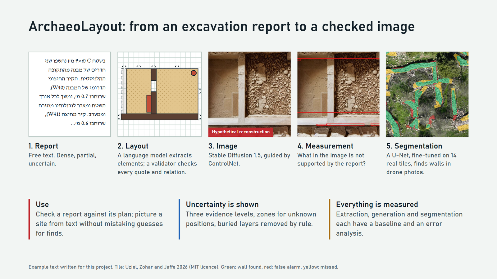
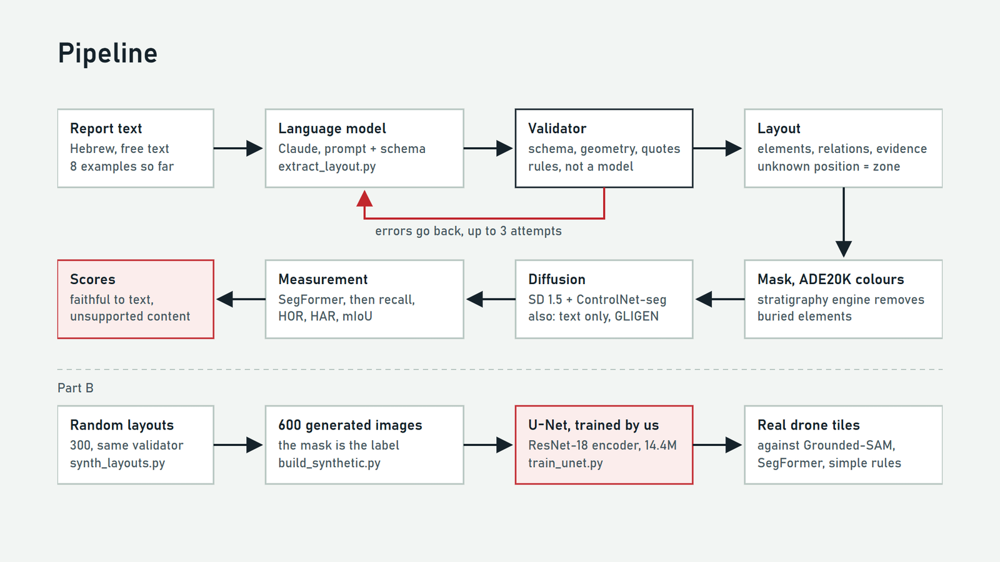
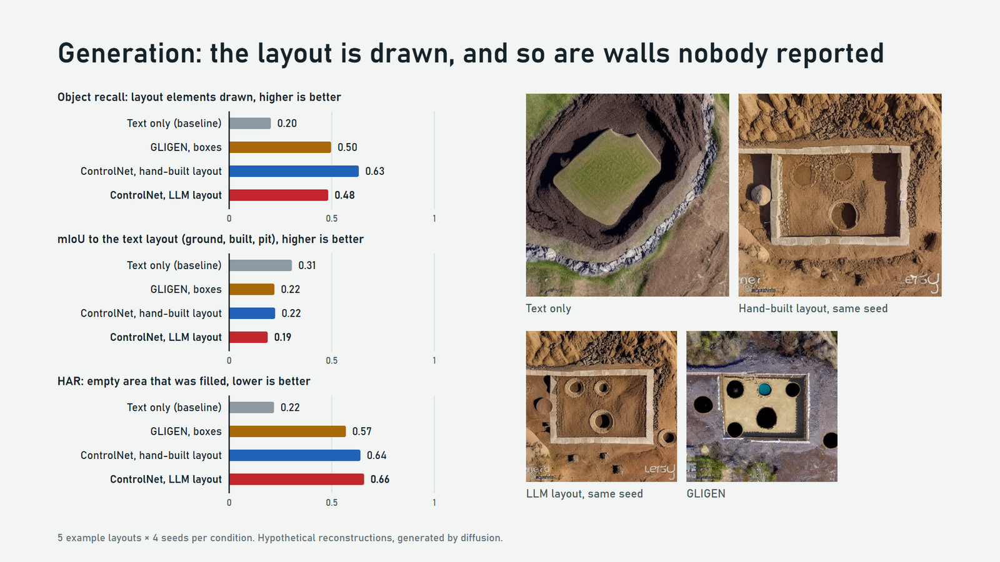
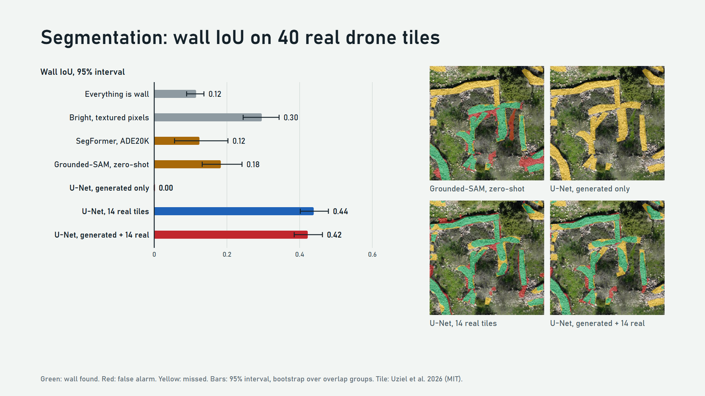
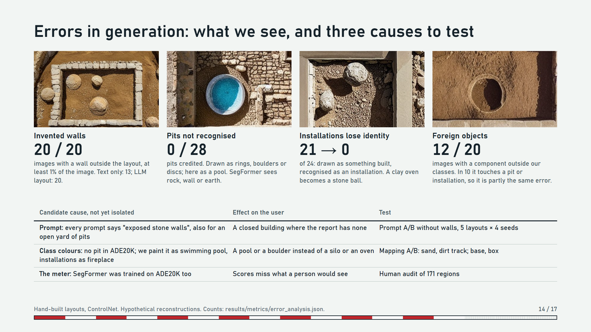
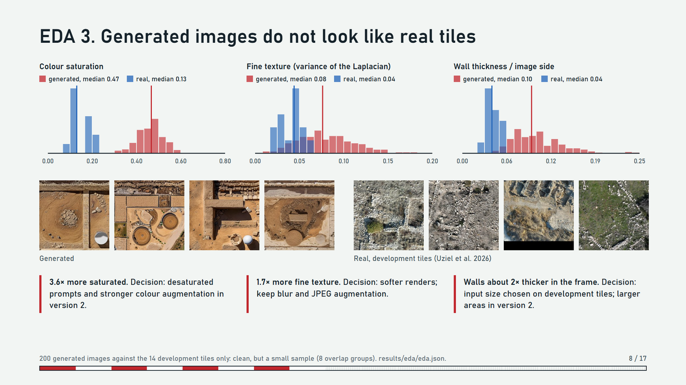

# ArchaeoLayout: from an excavation report to a site image, as far as the evidence goes

Course project in **Deep Generative Models**, Holon Institute of Technology (HIT), Fall 2026. Lecturer: Dr. Alexander (Sasha) Apartsin.
A language model turns a written excavation report into a spatial layout in which every element is backed by a quote. The layout guides a diffusion model, and the result is measured: what in the image does the report not support? A small segmentation network is trained on the generated images and tested on real drone photos.

[Hebrew README](README.he.md) · Slides: [interim](https://ssen2803.github.io/arch-to-image/midterm.html) ([pdf](slides/midterm.pdf), [pptx](slides/midterm.pptx)) · [proposal](https://ssen2803.github.io/arch-to-image/proposal.html) ([pdf](slides/proposal.pdf), [pptx](slides/proposal.pptx)) · [Data](data/README.md) · [Notebooks](notebooks)


*Visual abstract. Report, layout extracted by the language model, generated image, measurement, and segmentation of a real drone tile. The report text is an example written for this project. Generated images are hypothetical reconstructions.*

## Motivation

Excavation destroys what it uncovers; the report remains. Report editors check by eye that text and plans agree, researchers picture a site from dense text, and museums commission an artist or use an image generator that nobody checks. Generators fill every gap, and a convincing image reads as fact. In one of our examples the report describes a grain silo full of ash, and the model draws a blue swimming pool in the right place and at the right size.

## Problem statement

Given **a written excavation report** (Hebrew), produce **a structured spatial layout** and **a top-down image**, such that every drawn element is backed by a verbatim quote and unsupported content is measured.

- **Input:** free text of one report.
- **Output:** JSON layout (4 element classes, metres, 9 relation types, evidence level, quote), a 512×512 image labelled as hypothetical, and scores.
- **Constraints:** laptop GPU with 6 GB; unknown positions stay unknown; no Israel Antiquities Authority material without written consent.
- **Research question:** how much does a layout extracted by a language model improve spatial faithfulness over text alone, and how close does it come to a layout from the original plan?

### Input and output example

Report (example, translated): *"In Area C (9×6 m) two rooms of a Hellenistic building were exposed. The outer southern wall (W40), 0.7 m wide, runs along the whole area... The plaster floor stops in a straight line about 0.6 m from the western limit, and it is therefore proposed that the western wall of the room, whose stones were robbed, ran along this line..."*

What the language model returned for the proposed wall (Opus 5, unedited):

```json
{
 "id": "W4",
 "class": "wall",
 "subtype": "wall",
 "phrase": "robbed western wall of the room",
 "locus": null,
 "evidence": "hypothetical",
 "bbox": {
  "x": 0.1,
  "y": 0.7,
  "w": 0.5,
  "h": 5.3
 },
 "shape": "rect",
 "dims_source": "estimated",
 "position": "stated",
 "truncated": [
  "N"
 ],
 "term": {
  "value": "wall",
  "basis": "stated"
 },
 "source_span": "רצפת הטיח נקטעת בקו ישר כ-0.6 מ' מגבול החפירה המערבי, ומכאן מוצע כי לאורך קו זה עבר הקיר המערבי של החדר, שאבניו נשדדו"
}
```

Full layouts: [`02_layout_pipeline/examples/`](02_layout_pipeline/examples). `layout.gold.json` is the reference; `layout.pred.json` is what the language model extracted.

## Datasets

| Set | Size | Licence | Use |
|---|---|---|---|
| Example reports, written for this project | 8 texts, 40 elements, 52 relations | this repository | Extraction and generation pilot |
| Generated images | 600 from 300 layouts: 480 / 60 / 60 train / val / test | see [data/README.md](data/README.md) | Training the U-Net |
| Real drone tiles with wall outlines (Uziel et al. 2026) | 54 tiles: 14 development, 40 test | MIT | Development (settings, fine-tuning) and test |
| Report and plan pairs | not collected | consent requested | Main experiment |

Details, access, preprocessing and limitations: [data/README.md](data/README.md).

## Data generation and augmentation

- **Why synthetic:** we found no labelled excavation photos with floors, pits and installations.
- **How:** random layout → validator → class mask → ControlNet-seg on SD 1.5. The mask is the label. Code: [`synth_layouts.py`](04_cv_experiment/src/synth_layouts.py), [`build_synthetic.py`](04_cv_experiment/src/build_synthetic.py). Prompts and seeds are stored in [`manifest.csv`](04_cv_experiment/data/synthetic/manifest.csv).
- **Controlled attributes:** period, context, element types, sizes in metres, doorways, light, seed.
- **Checks:** schema and geometry validator, black-image retry, agreement with SegFormer, held-out U-Net, comparison with the real development tiles. Splits are by layout; 12 image pairs look alike by perceptual hash (5 across splits), and their labels show that they are different layouts.
- **Training augmentation:** scale, crop, rotation and flip, brightness, contrast, colour, blur, JPEG.

### What the exploratory analysis showed ([notebook](notebooks/01_data_exploration.ipynb))

| Finding | Number | Decision |
|---|---|---|
| Class imbalance | installations 1.8% of pixels | class weights, Dice, per-class results |
| Noisy labels | median agreement with SegFormer 0.24 | 3-pixel ignore band; human rating of a sample |
| The seed matters more than the layout | correlation 0.38 for other layout, same seed; 0.24 for same layout, other seed | unique seeds in version 2 |
| Domain gap (development tiles only, n = 14) | saturation 0.47 against 0.13; walls about 2× thicker in the frame | input size chosen on development tiles; prompts and scale change in version 2 |
| Leakage in the real tiles | 30 overlapping pairs (17 by a quarter, 13 at a corner), 2 photos labelled twice | split by overlap group |

## Models and pipeline


*Pipeline. Errors found by the validator go back to the language model, up to three attempts.*

| Stage | Model | Role | Trained? |
|---|---|---|---|
| Extraction | claude-opus-5, claude-sonnet-5 | report → layout | prompt only |
| Generation | Stable Diffusion 1.5 + ControlNet-seg; GLIGEN | layout → image | pretrained |
| Measurement | SegFormer-B4 (ADE20K) | image → class map | pretrained |
| Segmentation | U-Net, ResNet-18 encoder, 14.4M parameters | photo → classes | **trained and fine-tuned by us** |
| Segmentation baseline | GroundingDINO-tiny + SAM-B | zero-shot | pretrained |

## Training

| | Generated only | Fine-tuned on real tiles |
|---|---|---|
| Data | 480 images | 14 development tiles |
| Initialisation | ImageNet encoder | ImageNet, or the generated-only model |
| Optimiser, learning rate | AdamW, 1e-3 decoder, 1e-4 encoder, cosine, 1 warm-up epoch | AdamW, 3e-4 / 3e-5, cosine |
| Loss | cross-entropy with 1/√frequency weights + 0.5 soft Dice | same |
| Epochs, batch, crop | 40, 8, 384×384, FP16 | 30 (tiles × 10), 8, 384×384, FP16 |
| Checkpoint | best validation mIoU on generated images | last, fixed in advance |
| Seeds, hardware | 0, 1, 2; RTX 3050 Laptop 6 GB, about 15 min per run | 0, 1, 2; about 4 min per run |

## Evaluation and metrics

- **Extraction:** element precision and recall by overlap of quotes, relation precision and recall, box IoU, centre offset, invented positions.
- **Generation:** object recall, **HOR** (share of drawn objects without support), **HAR** (share of empty area that was filled). Definitions and calibration: [`measurement_HOR.md`](03_controlled_generation/measurement_HOR.md).
- **Segmentation:** mIoU on generated test images; wall IoU, precision, recall on real tiles. 95% intervals by bootstrap over layouts or overlap groups. Settings are chosen on the development tiles. The test evaluation ran three times: the search grids of two baselines (the bright-pixel rule and Grounded-SAM) were cut off at first and were widened on the development tiles; the trained models and their settings did not change. The error analysis looks at test tiles, so later versions will also be checked on fresh tiles. Deviations from the test protocol are listed in [test_set_protocol.md](04_cv_experiment/test_set_protocol.md), section 8.

## Results

### Extraction, 8 example reports

| | Valid | Elements found | Not in the reference | Relation P / R | Box IoU | Centre offset |
|---|---|---|---|---|---|---|
| claude-opus-5 | 8/8 | 39/40 | 1 | 0.79 / 0.81 | 0.59 | 0.20 m |
| claude-sonnet-5 | 7/8 | 40/40 | 0 | 0.95 / 0.75 | 0.64 | 0.28 m |

Elements are matched by the overlap of their quotes; relation scores merge inverse forms (strict scores: 0.77 / 0.79 and 0.95 / 0.75). The element that claude-opus-5 misses is the same wall, quoted from another sentence; the invalid layout of claude-sonnet-5 has a wrong code in an optional field. One run per model, so the variation between runs is not known. The reports and reference layouts were both written for this project, so these numbers are optimistic. A first run sent descriptive folder names to the model; these numbers are from a repeated run with neutral ids.

### Generation pilot, 5 layouts × 4 seeds, coarse classes ([all numbers](03_controlled_generation/outputs/summary.md))

| Condition | Object recall ↑ | mIoU ↑ | HOR ↓ | HAR ↓ | IoU ground / built |
|---|---|---|---|---|---|
| Text only (baseline) | 0.20 | 0.31 | 0.82 | 0.22 | 0.67 / 0.10 |
| GLIGEN | 0.50 | 0.22 | 0.76 | 0.57 | 0.40 / 0.17 |
| ControlNet, hand-built layout | 0.63 | 0.22 | 0.62 | 0.64 | 0.34 / 0.21 |
| **ControlNet, LLM layout** | 0.48 | 0.19 | 0.73 | 0.66 | 0.31 / 0.14 |


*Generation. The layout is drawn, and so are walls nobody reported.*

GLIGEN runs 50 steps on SD 1.4 (the other conditions: 30 steps on SD 1.5), and one of its 20 seeds was replaced because the safety filter returned a black image.

What recall counts: at this resolution walls and installations are one group, "built", and floors are ground. Elements drawn, of 40 walls, 24 installations and 28 pits: text only 15/6/0; GLIGEN 30/15/2; hand-built layout 38/21/0; LLM layout 32/16/0.

H1 is mixed (5 cases, descriptive). LLM layout against text only: recall +0.28, higher in 5 of 5 cases (exact sign-flip p = 0.06, the lowest possible with 5 cases); mIoU -0.12, higher in 1 of 5; HOR lower in 3 of 5. The layout adds built things in the right places and the generator adds walls on empty ground, so IoU of built things rises and IoU of the ground falls.

### Segmentation

| Model | Generated test, mIoU | Real tiles, wall IoU [95% CI] | Precision | Recall |
|---|---|---|---|---|
| Everything is wall | – | 0.115 [0.09, 0.14] | 0.12 | 1.00 |
| Bright, textured pixels (rule) | – | 0.296 [0.24, 0.34] | 0.40 | 0.54 |
| SegFormer-B4, ADE20K | 0.13 | 0.124 [0.06, 0.20] | 0.25 | 0.20 |
| Grounded-SAM, zero-shot | 0.13 | 0.183 [0.13, 0.24] | 0.24 | 0.45 |
| U-Net, generated only | 0.60 | 0.000 [0.00, 0.00] | 0.00 | 0.00 |
| U-Net, 14 real tiles | – | 0.439 [0.40, 0.48] | 0.61 | 0.62 |
| **U-Net, generated + 14 real tiles** | – | 0.422 [0.39, 0.46] | 0.63 | 0.56 |

The network trained only on generated images reaches mIoU 0.60 on generated test images (optimistic: 59 of 60 share a diffusion seed with training images) and finds no wall on real tiles, in all three seeds. The same inference code gives wall IoU 0.80 on generated images; changing size, saturation, blur or BatchNorm on the development tiles gives at most 0.07. Fourteen real tiles reach 0.44, +0.143 [+0.10, +0.20] above the best untrained model, the bright-pixel rule. Pre-training on generated images changes the result by -0.017 [-0.037, +0.005], so version 1 of the generated set does not help.

Notes. Intervals are approximate (bootstrap over 22 overlap groups, given 3 seeds). Grounded-SAM uses tuned wall settings on real tiles and default five-class settings on the generated test. Two labels of the same photo agree with IoU of about 0.7 (two photos, annotators unknown). Tiles do not name their site, so development and test may share sites. The authors of the tiles report pixel precision 0.80, recall 0.78 and F1 0.79 for walls (Mask R-CNN, 80% of the tiles for training, random split); our U-Net with 14 tiles has F1 0.61 on a split by overlap group. The settings differ, so the numbers are not directly comparable.


*Wall IoU on 40 real tiles and one example. Green: found, red: false alarm, yellow: missed.*

Files: [`results/metrics/`](results/metrics), [`results/predictions/`](results/predictions), [`results/eda/`](results/eda).

### Errors

| Category | How often | Candidate cause (not yet isolated) | Next step |
|---|---|---|---|
| Invented walls (hand-built layouts, ControlNet) | 20 of 20 images; text only 13 | every prompt says "exposed stone walls"; ADE20K floors are inside rooms | prompt A/B, conditioning scale |
| Pits | 0 of 28 credited; drawn as rings, boulders, discs, once a pool; SegFormer sees mostly rock, wall or earth (23 of 28) | no pit class in ADE20K; painted in the swimming-pool colour; the meter | mapping A/B; human audit |
| Installations | drawn as something built in 21 of 24, recognised as an installation in 0 | painted in the fireplace colour; the meter | mapping A/B |
| Foreign objects | 12 of 20 images, in 10 of them on a pit or installation | partly the same error as above | same tests |
| Shifted positions in extraction | median offset 0.20 m, walls 0.24 m | the text rarely bounds a position | tolerance-aware scoring |
| False walls on real tiles (fine-tuned U-Net, seed 0) | 13% of bright stone, 6% of soil | loose stones and bedrock look like wall stones | larger crops, transformer |


*Errors in generation, with counts.*


*Domain gap between generated images and real tiles.*

## Reproduce

Tested on Windows 11, Python 3.12, RTX 3050 Laptop 6 GB. A full run from zero was not repeated after the last change; the tests and the analysis scripts were.

```bash
py -3.12 -m venv .venv
.venv/Scripts/python -m pip install xformers==0.0.35 --index-url https://download.pytorch.org/whl/cu128
.venv/Scripts/python -m pip install -r requirements.txt
```

```bash
# tests: 156, none needs a GPU
cd 02_layout_pipeline      && ../.venv/Scripts/python -m pytest tests -q
cd ../03_controlled_generation && ../.venv/Scripts/python -m pytest tests -q
cd ../04_cv_experiment     && ../.venv/Scripts/python -m pytest tests -q
```

Commands are for Git Bash on Windows and run from the stage folder, after `PY=../.venv/Scripts/python`. Write `$PY` for `PY`.

```bash
# 02: extraction. Results used Claude Code in headless mode (models reported: claude-opus-5, claude-sonnet-5).
# The layouts are already in the repository; without --force existing files are kept
PY src/extract_layout_cli.py  examples/*/report.he.txt --model opus --force
PY src/extract_layout_cli.py  examples/*/report.he.txt --model sonnet --out-name layout.pred_sonnet.json --force
PY src/extract_layout.py      examples/*/report.he.txt --force  # alternative, not run for these results: direct API, needs ANTHROPIC_API_KEY
PY src/compare_layouts.py --all

# 03: generation, one layout as an example. Repeat for ex01..ex05
EX=../02_layout_pipeline/examples/ex01_iron_age_room
PY src/generate.py --layout $EX/layout.gold.json --style photo --seeds 0 1 2 3                     # hand-built layout
PY src/generate.py --layout $EX/layout.gold.json --style photo --seeds 0 1 2 3 --cond-scale 0      # text only
PY src/generate.py --layout $EX/layout.pred.json --style photo --seeds 0 1 2 3 --tag llm \
   --prompt "<the prompt in outputs/ex01_iron_age_room/photo_meta.json>"                           # LLM layout, same prompt
PY src/generate_gligen.py --examples ex01_iron_age_room --seeds 0 1 2 3
PY src/summarize.py && PY src/pilot_miou.py && PY src/pit_probe.py

# 04: data, training, evaluation
PY src/build_synthetic.py --n-layouts 300 --seeds 0 1                  # 600 images, about 2 hours; or unzip release data-v1
PY src/prepare_real_walls.py                                          # after downloading the tiles, see data/README.md
PY src/eda.py
PY src/train_unet.py --name base_s0 --hold-synthetic-test --seed 0     # also base_s1 --seed 1, base_s2 --seed 2
PY src/synth_test_eval.py
PY src/real_walls_eval.py --stage finetune
PY src/real_walls_eval.py --stage eval
PY src/domain_gap_probe.py
PY src/error_analysis.py

# slides, figures and README (results are read from the result files). Needs Node 22+, Chrome, and PowerPoint for the PPTX
cd slides/src && python build_decks.py
node export.mjs proposal && node export.mjs midterm && node export.mjs visuals --shots build/visuals
pwsh make_pptx.ps1 proposal; pwsh make_pptx.ps1 midterm
```

Environment variables: copy `.env.example` to `.env`. No secrets are stored in the repository.

## Repository structure

| Folder | Content |
|---|---|
| [`01_literature_review/`](01_literature_review) | Review of 35 works, coverage matrix |
| [`02_layout_pipeline/`](02_layout_pipeline) | Ontology, JSON schema, extractor, validator, renderer, 8 examples, tests |
| [`03_controlled_generation/`](03_controlled_generation) | SD 1.5 + ControlNet / GLIGEN, hallucination metrics, images and scores, tests |
| [`04_cv_experiment/`](04_cv_experiment) | Generated training data, U-Net, zero-shot baselines, evaluation, tests |
| [`05_presentation/`](05_presentation) | Earlier project briefs in Hebrew (17 Nov 2026), before the results; not updated since |
| [`data/`](data) | Data documentation and samples |
| [`notebooks/`](notebooks) | `01_data_exploration`, `02_baselines_and_errors` |
| [`results/`](results) | Metrics (JSON, CSV), predictions, EDA numbers |
| [`slides/`](slides) | Proposal and interim slides: PPTX, PDF, HTML ([in the browser](https://ssen2803.github.io/arch-to-image/)); sources in `src/` |
| [`visuals/`](visuals) | Visual abstract, pipeline, result figures |

Documentation inside the stage folders is in Hebrew.

## Team

**Sean Geller Yanovich** (one-person team): problem definition, literature review, data generation and preparation, implementation, training, evaluation, documentation. AI coding assistants were used for implementation and drafting; results were produced by the code in this repository.

## Licence, citation and credits

Code and generated data: [MIT](LICENSE). Real tiles: Uziel, Zohar and Jaffe, *J. Archaeol. Sci.* 185, 2026, 106430, [data](https://doi.org/10.5281/zenodo.15673668) (MIT). Models: Stable Diffusion 1.5, ControlNet, GLIGEN, SegFormer, Grounding DINO, SAM, Claude. No Israel Antiquities Authority text, plan or photo is included.
